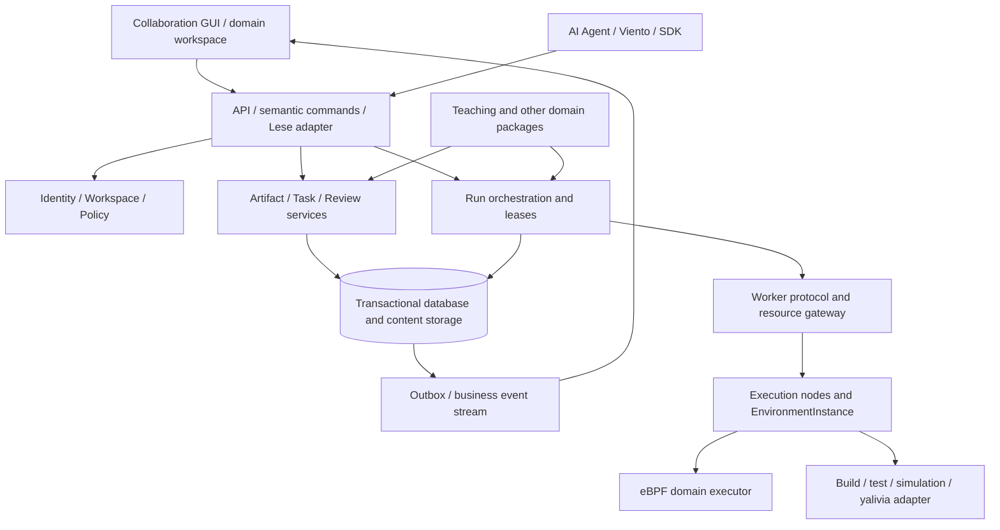

# Cyanrex Next Generation Architecture

Status: long-term architecture proposal and implementation comparison v0.5 · Initial draft: 2026-09-27 · Implementation comparison updated: 2026-10-03

Target repository: `Team-silvortex/cyanrex-lab` · This work does not reset the Cyanrex software version line.

Product position: collaboration software for humans, AI Agents and compute resources, preceding the Nuis OS work collaboration environment.

## 0. Scope, evidence and key decisions

This design is based on the `main` snapshot of `Team-silvortex/cyanrex-lab` at
`f36f2bdcd4732f6eb78a1631520f9e8143f5cb4d`, committed on 2026-09-25, version 0.4.3.
The review covered architecture/status documents, Rust routes/services/domain structures, SQL migrations,
Runner and Agent protocols, module manifests, SDK stability policy, and frontend dependencies/feature
boundaries. This was a static review: it did not start the privileged Engine, access an existing
database or rerun application tests.

The new direction comes from the user's explicit request: elevate the general capabilities of the
eBPF teaching system into collaboration models such as Identity, Workspace, Artifact, Task, Run,
Review, Event, Capability and Agent. Teaching remains the first formal domain package; renaming
does not remove existing workflows.

The target models, modules, API paths, protocols and phase numbers in this design are proposals.
Lese, yalivia, ns-nova and other Nuis tools were not separately reviewed in this work. Integration
points describe required contracts, not existing interfaces or implementations.

Six decisions are recommended:

1. **Workspace becomes the collaboration and authorization boundary; identity is no longer tied to a lifelong teacher/student role.**
2. **Model Artifact, Task, Run and Review separately.** A work objective, content version, execution and judgment cannot be combined into one attempt.
3. **Separate AI Agents from execution nodes.** The existing Runner Agent is a node execution client, not automatically an AI with planning capabilities.
4. **Keep the general control plane unprivileged; independent execution environments perform domain execution.** Initially retain an explicit legacy local mode and progressively complete actual process separation.
5. **Core state and business events must support durable recovery.** The existing event center remains telemetry and cannot directly serve as a reliable workflow journal.
6. **Begin with a modular monolith, then separate processes where operation and isolation require it.** Do not introduce distributed microservices initially or require Nuis OS to be complete.

### 0.1 Current implementation position and delivery boundaries

As of 2026-10-03, Cyanrex has progressed from the initial draft to identity/resource preparation
and local Task content editing. The product follows its existing version line through 0.4.9,
without a reset. This design retains the initial 0.4.3 review evidence and long-term proposal.
Current complete capabilities, release boundaries and verification records are maintained in
[project status](project-status.md), [system architecture](architecture.md) and
[development history](development-history.md). This update does not represent a rerun of application
acceptance or a deployment change.

| Roadmap area | Current implementation position | Phase objectives not yet delivered |
|---|---|---|
| C0 and C-M1 | Core types, pinned source inventory and offline projections of old permissions entered 0.4.4 | Actual deployed data/fallback-source/runtime-resource inventory and recovery drills cannot be inferred from source |
| C1 identity and authorization | 0.4.4–0.4.7 progressively provide identity registration, membership/deployment policy, transactional audits, durable Sessions, lifecycle commands, empty-database bootstrap and read-only reconciliation | Live AuthService connection, recovery, and a reviewed switch to one write authority |
| C2-A through C2-F | 0.4.8 includes domain catalogue decoupling, Task/Artifact/Review stores and Session-private Task/Artifact commands | Public platform HTTP/SDK and UI workflows, old attempt migration and teaching compatibility projections |
| C2-G through C2-J | 0.4.9 includes exact Task inputs, Session-private human Review, catalogue Task admission and Draft input replacement | Sharing/cross-user review, typed evidence/policy execution, Task acceptance and real user collaboration |
| Task payload UI | Local Task drafts included in 0.4.9 own optional text; 14 language profiles, with code only one content-item kind | Server content-metadata contracts, public authorized adapters, explicit save/conflict UI and end-to-end acceptance |
| C3 through C6 | Retain the original local Runner, remote compile-only Agent and internal SDK as foundations | Durable general Run, business-stream delivery, isolated Workers, AI delegation and ecosystem integration do not yet form complete workflows |

Identity and operational preparation contracts extend from [ADR-001](collaboration-foundation.md) to
[the durable authentication source](collaboration-auth-source.md),
[Session collaboration commands](collaboration-session-commands.md),
[explicit provisioning](collaboration-provisioning.md) and
[read-only reconciliation](collaboration-reconciliation.md). These components have their own
transaction/failure boundaries but do not switch the live login, account or teaching database.

Task foundations are described in [catalogue boundaries](task-domain-boundary.md),
[Task](task-instance-store.md), [Artifact](artifact-revision-store.md),
[Review](review-record-store.md) and their respective Session commands.
[Exact Task inputs](session-task-inputs.md), [private human review](session-review-commands.md),
[catalogue Tasks](session-catalog-tasks.md) and [Draft input replacement](session-task-revisions.md),
included in 0.4.9, remain preparation layers. Frozen catalogue definitions and private opinions do
not mean a policy has executed, grant cross-user permission or accept a Task. Task Schema 2 permits
only fresh installation in an independent namespace, without automatic Schema 1 migration. Content
publication and Task reference replacement are separate; failures do not justify file cleanup or
blind retries.

The [Task payload editor](editor.md) primarily opens at `/tasks/new`; `/editor` enters the same
container. Content remains in page memory; a download is not server saving. There is no external
LSP, project filesystem or general execution. The near-term priority is one private, non-teaching
content-save path before shared review/acceptance. See [next decision points](project-status.md#next-decision-points)
for the detailed sequence. None of this represents complete acceptance of C2 or C-M5.

The 2026-10-07 [C2-O draft publication plan](task-draft-publication.md), included in 0.5.3, adds strict
Rust import, bounded text publication values and manifest mapping from supplied exact content.
It does not publish, connect the browser or change the historical version records above.
[C2-P](session-task-draft-publication.md), included in the same version, provides internal stepwise
publication and an in-memory confirmed prefix; [C2-Q](session-task-draft-observation.md) only observes
the current state of an unknown target. [C2-R](session-task-draft-checkpoint.md) separately provides a
bounded metadata checkpoint whose parsed result remains data. [C2-S](session-task-draft-inspection.md)
can inspect one checkpoint target with an explicit workspace and current Session, without requiring
the original attempt to remain alive. It does not authenticate the original caller, original bytes
or storage generation, and does not replace C2-Q's original-Session requirement. These slices do not
form a durable intent journal, restart recovery or retry protocol. Session issuance, deployment
composition and browser saving still require separate review.

[C2-T](session-task-draft-intent.md), included in 0.5.4, separately adds immutable intent registration
for a real Ready/zero-confirmation attempt. The record binds the current owner and exact account
incarnation and allows a new Session with that same binding to read it. It does not restore an
attempt or prove a resource commit. Old C2-P still does not depend on a journal.
[C2-U](session-task-draft-dispatch.md), included in 0.5.4, consumes the original attempt into a live
wrapper, separately providing a path that first confirms an Unknown step and then jointly commits
the resource/marker under the bound identity. It does not upgrade Schema 1 or restore the wrapper
from records; restart recovery and public saving remain separate work.

[C2-V](session-task-draft-journal-inspection.md), included in 0.5.4, separately provides current-Session
Schema 2 journal inspection: a complete committed-prefix count and optional Unknown target, without
reading actual resources. A new Session must still match the exact owner/account incarnation.
Missing records or all steps being recorded neither revive the wrapper nor authorize retry/cleanup.

[C2-W](session-task-draft-journal-observation.md), included in 0.5.4, separately observes one recorded
target, reads the actual resource within the same authorized transaction and rechecks the original
complete journal/first identity. Body-free output distinguishes recorded state from the current
metadata result; it provides no receipt or recovery. C2-V remains journal-only. Public saving and
handling unknown outcomes remain separate work.

Further Linux implementation must observe these gates:

1. Complete the deployment inventory before actual data migration: distinguish PostgreSQL, files and volatile state; preserve existing changes; do not treat C0's source inventory as a deployment inventory.
2. Retain stable identity, membership, explicit deployment rights and one write authority. Verify unchanged permissions with teacher, student and administrator examples; renaming is not migration.
3. Back up first and verify restoration in an independent test database before C-M2 offline attempt conversion. Cover failure, failure after passing, multi-revision comments and repeated source; publish only sanitized reconciliation evidence.
4. Accept public adapters, UI saving and old API-compatible reads separately. Plan maintenance windows, incremental reconciliation and rollback separately for online write switching; do not test migration on the live database or use best-effort dual writes.
5. Use compile-only Run without kernel loading in C-M4 to verify durability, leases, cancellation and recovery before expanding general execution. Do not treat Runner Agent as AI Agent or open arbitrary remote code execution.
6. Report actual delivery, data/permission differences, test evidence and failed items for each phase separately. Use dedicated environments for actual kernel/privileged acceptance; do not test cleanup, resets or fault injection on teaching or production instances.

Implementation scope is limited to the explicitly selected phase. This design does not authorize
deleting old tables, expanding permissions, stopping services, running privileged migrations or
automatic publication. Related design/build boundaries are described in
[Viento Studio Next Generation Architecture](https://github.com/Team-silvortex/viento-studio/blob/main/docs/NEXT_ARCHITECTURE.zh-CN.md).

## 1. Initial architecture and capability review baseline

This section describes the 0.4.3 source pinned to 2026-09-25. “Current” and “not yet available” in its
tables refer to that historical baseline, not the 2026-10-03 working tree. Subsequent identity,
Task, Artifact, Review and editor capabilities are described in section 0.1 and project status.

### 1.1 Runtime topology and module boundaries

The existing system comprises a Next.js/React frontend, Rust/Axum Engine, PostgreSQL, local Linux
compilation/kernel tools and an optional remote compile Agent. The browser owns interaction;
Engine simultaneously owns authentication, authorization, persistence, business logic and privileged
eBPF execution. Source-level control/execution interfaces exist, but the runtime topology has not
completed separation between an unprivileged control service and a privileged execution service.
[C1][c-architecture] [C2][c-state]

| Module | Currently verified capabilities | Next-generation home |
|---|---|---|
| `frontend/` | Workbench, Monaco, learning/teaching, events, settings, structured terminal, four-language UI | General collaboration Shell + eBPF/teaching domain workbenches |
| `application.rs`, `routes/` | Routes organized into public, authenticated, teacher and Agent protocols; Session/CSRF/role guards | Transport adapters and authorization contexts, retaining old endpoint adapters |
| `AuthService`, `ClassroomService` | Password/TOTP, Cookie Sessions, teacher authority, invitations and enrollment discovery | Identity, Membership, Invite and Policy services |
| `LearningStore`, `learning_catalog` | Five built-in labs, attempts, progress, automatic feedback, teacher comments and historical-submission recovery | Teaching domain package + Task/Run/Review projections |
| `ScriptStore` | User source scripts and database/file storage | Artifact and version-management entry |
| `EventBus` | User event history, realtime queues, retention, unread/export/delete and persistence | Telemetry/notification channel; reliable business events need a separate transaction boundary |
| `RunnerManager`, `RunnerDriver` | Local execution leases, quotas, timeouts, diagnostics/completion, attachment listing and detach interfaces | Scheduling/lease services + eBPF execution adapters |
| Agent Registry/Queue/Client | Signed registration, heartbeats, claims, lease synchronization, cancellation and results; probes and compile checks | ComputeNode, WorkerSession, JobLease and durable job queue |
| `ModuleManager`, `CommandDispatcher` | Declarative catalogue discovery, in-memory start/stop and limited administrative commands | Extension catalogue and general semantic-action registry |
| `sdk-js/`, OpenAPI | Typed clients, generated operations, contract drift and compatibility checks | Retain as formal compatibility surfaces; add general APIs incrementally |

Existing CommandDispatcher has only four command categories: list modules, start/stop modules and
enter a lab. `RunExperiment` returns the eBPF workspace path rather than executing a program.
Module start/stop only changes in-memory state, and manifest discovery does not execute module code.
Both are foundations for generalization, not yet a general automation bus or executable plugin system.
[C3][c-command] [C4][c-modules]

### 1.2 Initial data model and coupling

| Current entity | Current key fields/facts | Limitation |
|---|---|---|
| User/Session | `users.username` primary key; password digest, TOTP; Session-owned username | Display/login names are coupled to durable owners; no general Principal ID |
| AuthRole | `Admin/Teacher/Student`; legacy admin is equivalent to teacher deployment authority | Roles depend on instance configuration, without Workspace scope |
| LabDefinition | `id/position/title/summary/doc_slug/template_id`; lab rules live in service code | Course catalogue, Task templates and acceptance rules are coupled |
| LabAttempt | ID, username, lab/template, source/digest, execution success/stage, attachment evidence, completed, automatic feedback and comments | Combines input snapshot, execution result and review |
| TeacherFeedback | reviewer, comment, revision, updated_at | Optimistic versioning exists; stores the latest comment, not a complete revision history |
| UserScript | ID, username, title, script, creation/update times | Mutable content record, without an independent immutable ArtifactRevision |
| Event | username, time, source, type, kernel/platform, severity, color, payload | Public events have no event ID/cursor; the online recovery contract does not expose the database BIGSERIAL |
| RunnerLease | runner_id, username, backend, start/deadline | A capacity/execution lease, not long-lived attachment ownership |
| RunnerAgent | agent_id, version, declared isolation, capabilities, capacity, health, heartbeat | Registry is currently in memory; self-reported capabilities do not replace actual isolation verification |
| RunnerJob | job_id, kind, state, target/execution agent, optional owner, source, result, lease/deadline | In-memory queue cannot reliably recover active work after restart |

These models can be cross-checked directly against domain structures and SQL migrations. The current
database has users, Sessions, events, scripts, learning attempts and comment columns, but no general
Workspace/Task/Artifact/Review tables.
[C5][c-learning-model] [C6][c-event-model] [C7][c-runner-job] [C8][c-migrations]

### 1.3 Initial capabilities and boundaries that must not be confused

- The local eBPF workbench provides Clang checks/completion, bpftool and some Aya tracepoint paths, attachment management and event observation. Source breakpoints are observation probes, not kernel-program pauses.
- The local Runner explicitly uses `shared_kernel`. Quotas, per-user namespaces and directory isolation do not constitute independent kernel sandboxes.
- The independent Runner Agent supports `control_probe` and optional compile-only `ebpf_compile_check`; it neither loads eBPF remotely nor returns object files. `/ebpf/run` still executes locally.
- RunnerDriver abstracts execution, checks, completion, inventory and detach, but attachment verification, event streams, environment inspection and compilation settings remain locally coupled. Replacing a driver is not complete remote migration.
- EventBus has user isolation, bounded queues and history recovery, but not durable cursor replay or an exactly-once protocol.
- Engine remains a single process. Attachments, modules, registry, queue and some fallback state are not shared across replicas. Database-failure fallback policies differ by service/operation and cannot all be treated as reliable durability.
- SDK/OpenAPI is a usable internal contract. Documents record 63 non-Agent operations and 77 protected named paths. Public Registry publication, long-term support and artifact acceptance cannot be inferred from “source version 0.4.3.” [C1][c-architecture] [C9][c-runner-agent] [C10][c-status]

## 2. Vision, core workflow and non-goals

On entering a Workspace, users should know who is doing what, with which content, where it runs,
what it produced, who confirmed it and who is needed next. Humans can perform Tasks directly or
authorize AI to decompose work, propose changes, use compute resources and submit results.

The core interaction is: **create a collaboration space → publish/reference content → define Tasks
and acceptance → assign humans or Agents → run in a suitable environment → retain evidence → review
→ iterate.** A Task can be completed entirely by humans; an Artifact can exist without a Task;
a Run can have multiple inputs/outputs. Teaching must not hard-code these relationships.

Nuis OS may eventually connect identity, resources and tool services to these boundaries. For now,
Cyanrex is independently deployable software that can operate through ordinary browsers and existing
Linux compute nodes.

Non-goals:

- Do not initially implement a complete operating system, general cloud scheduler or all features of an enterprise chat product.
- Do not hard-code teacher/student, lab, eBPF, grading rules or classroom layout into the general core.
- Agent registration and capability strings do not promise arbitrary program execution or multi-tenant isolation.
- Do not require AI for every activity or give AI final approval over its own output by default.
- Do not promise exactly-once execution of arbitrary distributed external actions, cancellation as rollback or automatic restoration of every physical environment after restart.

## 3. Core abstractions and relationships

| Abstraction | Definition | Key boundary |
|---|---|---|
| Identity / Principal | An authenticated, authorized and accountable subject: human, agent, service or machine | Stable IDs are separate from login/display names and authentication providers |
| Workspace | Collaboration boundary for membership, policy, work and content | The same subject can have different permissions in different spaces |
| Membership / Grant | Membership and authorization for concrete actions/resources | Global deployment rights are independent of work roles within a space |
| Artifact / ArtifactRevision | Stable content identity and immutable version: documents, source, design snapshots, data, outputs or reports | Access control applies to logical content; a digest is not an access credential |
| Task / TaskDefinition | Work-objective instance and reusable workflow/acceptance definition | A Task may have zero or more Runs; it is not one execution |
| Run | One execution record with fixed inputs, environment requirements and execution contract | A retry creates a new Run with `retryOf`, without rewriting history |
| Review | A subject's judgment about an exact version/execution evidence | Identify human, rule-based and AI evaluations separately |
| Event | A fact associated with a subject, space, object and cause | Business facts, audits, telemetry and notifications have different retention policies |
| CapabilityDefinition | Typed definition of an action or technical capability | Distinguish permission from ability |
| Agent | An automated participant working as a Principal with tool/delegation policy | Agent configuration is separate from a work session; there is no inherent administrator authority |
| ComputeNode / WorkerSession | A node providing compute/devices/toolchains and its current connection | Workers run jobs; connectivity does not prove environment availability or adequate isolation |
| EnvironmentInstance | A concrete execution environment allocated to a workload | Track owner, lifecycle, isolation and cleanup evidence |
| Lease / RuntimeResource | Short-lived execution rights and resources that remain alive afterward | A finished Run does not mean attachments, containers or devices have been released |

Distinguish two kinds of Capability: `Grant(action, scope, conditions)` expresses permitted actions;
`CapabilityOffer(name, version, limits, evidence)` expresses an execution environment's technical
abilities. Dispatch requires both authorization and technical conditions. A node claiming
`ebpf.attach` does not authorize the node or caller.

## 4. Module layering and deployment boundaries



| Module | Data and behavior it owns | What it explicitly does not own |
|---|---|---|
| Identity & Policy | Principal, authentication links, Membership, Grant and delegation | Source execution or domain acceptance details |
| Artifact Service | Metadata, immutable versions, relationships, visibility and content retention | Task state or execution scheduling |
| Work Service | TaskDefinition, Task, dependencies, assignment and acceptance policy | Internal node runtime lifecycle |
| Review Service | Review, version conditions, reviewer permissions and judgment provenance | Silently rewriting reviewed content |
| Execution Control | Run, resource selection, leases, cancellation, recovery and state reconciliation | Executing kernel code directly in the control process |
| Worker Gateway | Node identity, heartbeats, claims, results and resource protocols | Granting Workspace authority based on Agent self-reports |
| Domain Packages | Models, views and validators specific to teaching/eBPF/build/research | Arbitrary core-table changes or bypassing core authorization |
| Events & Projections | Business-event delivery, notifications, read models, search and telemetry adapters | Inferring committed business facts from lossy telemetry |
| Integration Layer | Viento, Lese, yalivia, ns-nova and Nuis adapters | A duplicate identity/Task fact store |

Initially retain Rust/Axum, Next.js and PostgreSQL, extracting boundaries within
`models/services/routes`. One general service process can remain; privileged executors run in
separately managed processes/environments. The old integrated Engine mode must be marked as a
legacy trusted-local mode. Renaming modules cannot establish an unprivileged control plane.

## 5. Key data models and constraints

### 5.1 Minimal core tables and records

This is a target Schema draft, not a description of the existing database.

| Record | Key fields |
|---|---|
| `Principal` | `id, kind, displayName, status, createdAt` |
| `IdentityBinding` | `principalId, issuer, subject, legacyUsername?` |
| `Workspace` | `id, name, kind, policyVersion, revision, createdBy` |
| `Membership` | `workspaceId, principalId, roleRefs, status` |
| `CapabilityGrant` | `id, principalId, workspaceId?, actions, resourceScope, conditions, expiresAt?, delegatedBy?` |
| `Artifact` | `id, workspaceId, kind, title, ownerId, visibility, headRevisionId, revision` |
| `ArtifactRevision` | `id, artifactId, parentRefs, contentRef, digest, mediaType, schemaRef, createdBy, provenance` |
| `TaskDefinition` | `id, version, packageRef, inputSchema, outputSchema, workflow, acceptancePolicy` |
| `Task` | `id, workspaceId, definitionRef?, title, descriptionRef?, assigneeRefs, dependencies, inputRefs, status, revision` |
| `Run` | `id, workspaceId, taskId?, requestedBy, onBehalfOf?, agentSessionId?, inputRevisionRefs, executionSpec, environmentRef?, state, stateVersion, retryOf?, outputRevisionRefs` |
| `Review` | `id, workspaceId, targetRefs, reviewerId, reviewerKind, verdict, commentRef?, evidenceRefs, policyVersion, revision, supersedes?` |
| `AgentProfile` | `id, principalId, operatorId, adapterRef, toolPolicyRef, budgetPolicy, modelConfigRef?` |
| `AgentSession` | `id, agentId, workspaceId, taskId?, delegationRef, contextRefs, status, usage, startedAt, endedAt?` |
| `ComputeNode` | `id, machinePrincipalId, approvedOffers, labels, enrollmentPolicy` |
| `WorkerSession` | `id, nodeId, protocolVersion, credentialRef, epoch, health, reportedOffers, lastHeartbeat, expiresAt` |
| `EnvironmentInstance` | `id, nodeId, ownerRef, isolationKind, verifiedProperties, imageOrToolchainDigest, lifecycle, resetEvidenceRef?` |
| `RunLease` | `id, runId, workerSessionId, fencingToken, expiresAt, state` |
| `RuntimeResource` | `id, runId, environmentId, ownerId, kind, runtimeHandle, state, cleanupEvidenceRef?` |
| `EventEnvelope` | `eventId, schemaVersion, workspaceId, aggregateRef, aggregateRevision, actorId, type, occurredAt, recordedAt, correlationId, causationId, payloadRef?` |

Time fields record only known facts. When importing old records, unknown start/end times, execution
nodes or toolchain versions remain unknown with their provenance recorded. Do not fabricate runtime history.

### 5.2 Data invariants

- Durable ownership uses Principal ID; `username` remains a compatibility identity mapping. Session authentication can initially remain unchanged. Introducing IDs must not force every user to replace passwords or TOTP.
- Core resources must have a Workspace or explicit instance-level scope. Cross-space references require a dedicated Grant; knowing a UUID does not provide access.
- Published ArtifactRevision records are immutable in place; editing creates a new version. Content blobs can be deduplicated by digest, but permissions cannot be shared through global blobs.
- A Run fixes input revisions, executor version and environment requirements. Result outputs also register as ArtifactRevision. Automatic-check success and human business approval are recorded separately.
- Review binds concrete versions. Old Reviews may remain after input changes, but cannot be shown as approval of a new version.
- Task state, Run state and Review judgment are independent. A failed Run can be retried; Task completion depends on its acceptance policy.
- Run transitions compare `stateVersion` and the valid lease epoch. An old Worker with an expired lease cannot submit a valid result.

### 5.3 Persistence and recovery

Core facts use relational models and transactions. Extension fields use namespaced, Schema-defined
JSON rather than turning the system into an untyped JSON container. Artifact metadata lives in the
database; content lives in versioned files/object storage. Upload and verify content before publishing
references in a transaction. Unpublished content is cleaned under a separate policy.

Task/Run/Review changes and outbox entries commit in the same database transaction. A Dispatcher
publishes committed outbox entries to a durable event stream; consumers deduplicate by eventId.
Complete event sourcing is not initially required, nor is reconstructing business tables from telemetry.

When durable storage is unavailable, the new general core should reject writes that require reliable
commitments and display unconfirmed/unavailable state. It must not report success and then fall back
to volatile queues. File/in-memory fallback in the old mode may continue under explicit legacy
configuration, but must be exported/reconciled before crossing the migration boundary. Two backends
must not simultaneously act as independent authorities.

Agent keys, authentication material and secret configuration belong in an independent Secret Provider
or secure host storage; business records retain references only. Historical Session digests and
account data retain existing authentication boundaries. Do not perform unrelated authentication
rewrites before implementing the core space model.

## 6. Execution, collaboration and interaction workflows

### 6.1 A general collaboration chain

Consider modifying a Viento World and comparing two solver-parameter sets:

1. A human publishes a World snapshot as an ArtifactRevision, creates a Task and declares acceptance metrics and permitted compute environments.
2. Assign the Task to a human or AI Agent. An AgentSession receives delegation limited to the space, inputs and action set.
3. The Agent submits a change proposal or new ArtifactRevision, creates two Runs with fixed inputs and selects a qualified Provider.
4. The Scheduler verifies authorization, budget, capability, capacity and isolation requirements. A Worker claims a lease and executes in an EnvironmentInstance.
5. Output data, log summaries and reports register as ArtifactRevision. The Run completes with recorded environment, toolchain and input provenance.
6. Rule checks produce automatic Reviews. A human reviews differences/evidence under policy and approves the exact version.
7. The Task becomes accepted or generates the next round of work. Viento commits design changes itself according to the approved ChangeSet.

Human writing or design review without execution can proceed directly through Artifact → Review → Task.
The framework must not require users to create a fictitious Run to complete their work.

### 6.2 Task and Run state machines

The suggested base Task states are `draft/ready/in_progress/blocked/in_review/accepted/cancelled`.
Domain packages may define display names and controlled workflow extensions. Record the completion-policy
version in the Task; template upgrades must not silently change existing acceptance criteria.

```text
Run: requested → queued → leased → running → succeeded | failed
                        ↘ cancel_requested → cancelled
     queued → cancelled | expired
     leased/running → reconciling → verified terminal state | unknown
```

Cancellation is a request. Report cancelled only after the execution environment confirms that work
stopped or reconciliation establishes completion. Network loss, lease expiry and browser exit do not
prove a program stopped. If external effects may remain, enter reconciling/unknown. Retries must create
new Runs with `retryOf` and business idempotency keys. Non-retryable actions require human or policy
confirmation of the previous execution outcome.

Leases and fencing tokens reject late updates from old Workers; they do not provide exactly-once
physical execution. Executors supporting idempotent external writes should pass the same effect key
to the system that actually produces side effects. Otherwise, record uncertain outcomes accurately.

### 6.3 Execution resources and long-lived state

General scheduling considers more than online status/free slots: it must match approved technical
capabilities, input formats, toolchains, isolation levels, Workspace visibility and budget. Self-reported
node labels support discovery; properties required for environment admission must be confirmed by the
appropriate deployment or verification process.

Separate short-lived RunLease from long-lived RuntimeResource. After a successful eBPF load, for
example, programs/links/pins can remain alive. Finishing a Run or releasing a concurrency slot must not
lose their owner and detach path. EnvironmentInstance transitions through
`allocated → preparing → ready → in_use → draining → resetting → ready/destroyed`.
Unconfirmed cleanup enters quarantine rather than automatically handing the environment to another user.

RunnerDriver must continue adding lifecycle capabilities such as
`inspectEnvironment/prepareInputs/execute/observe/listResources/cleanup/resetEvidence` to support general
remote execution. These are target protocol responsibilities, not a requirement to add every method
to one trait at once. Selected headers' host paths must become verifiable input packages rather than
being passed directly to a remote executor. [C11][c-runner-driver]

### 6.4 Review and feedback

Review provenance is human, rule or agent. Automatic validators record rule versions, input digests
and evidence; AI opinions record AgentSession and content provenance. Domain policy determines which
sources satisfy acceptance. AI cannot, by default, complete a Task requiring human approval through
self-evaluation.

Editing comments creates new revisions, retaining `supersedes` and the target at review time. Check
the expected revision before editing, preserving existing teacher-feedback conflict protection.
A higher-level GUI can show the current comment while the underlying layer retains change history.
When only the final version survives an old-system import, mark earlier history as unavailable.

### 6.5 Events, telemetry and reconnection

| Channel | Examples | Durability and recovery |
|---|---|---|
| Domain Event | TaskAssigned, RunCompleted, ReviewSubmitted | Business-transaction outbox, durable delivery and cursor replay |
| Audit Event | Permission grants, delegations, resource approvals | Append-only records; explicit administrative policy controls deletion/redaction |
| Telemetry | Kernel events, stdout, sampled metrics | Bounded cache/batch storage; sampling and drops allowed with reported gaps |
| Notification | Unread items, pending reviews, mentions | Derived from business events, rebuildable and user-readable |

Event transport deduplicates with `eventId` and recovers with a separate `streamOffset`. Offsets are
allocated in stream order when committed events enter the durable stream; database primary keys
that may be allocated before commit must not become gap-free commit cursors. Guarantee only declared
stream/aggregate order, not global order across all Workspaces.

Clients first obtain a snapshot with a watermark, then subscribe after that watermark. An expired
cursor returns `cursor_expired` and requires a new snapshot. Consumers must tolerate duplicate delivery.
Retain compatibility for old `/ws/events`; version the new business stream independently. Clearing user
telemetry history cannot remove the basis of Task state or review audits.

### 6.6 Semantic GUI and action confirmation

The collaboration UI centers on Workspace overview, Artifacts, Tasks, Runs, Reviews, Agents & Resources
and Events. Teaching packages organize these into learner/teacher views. The terminal page may remain
a structured command interface rather than becoming a system Shell.

Every action exposes `actionId/targetRef/inputSchema/preconditions/effects/requiredGrant/operationId`.
Human buttons, keyboards, SDKs and AI use the same application services. After submission, the UI
distinguishes request received, state confirmed and uncertain outcome. Navigation only cancels waiting;
it must not pretend to revoke server operations, retaining existing effective frontend safeguards.

## 7. Plugins, templates and extension mechanisms

### 7.1 Domain packages

Define eBPF Teaching Pack as the first domain package, combining course/lab TaskDefinitions, template
source Artifacts, acceptance rules, eBPF executor requirements, teacher/student role presets, editors
and review views. The general core sees only Task, Artifact, Run, Review and capability conditions.

| Extension point | Declared content | Constraint |
|---|---|---|
| Artifact Kind | Schema, previewer, diff viewer, indexed fields | Preserve downloadable content for unrecognized types without damaging objects |
| Task Template | Inputs/outputs, steps, acceptance and required roles | Instances pin a definition version |
| Review Provider | Rules, tools or human forms | Results identify provenance without expanding their own approval authority |
| Execution Provider | Job types, inputs/outputs, resource requirements, cancellation and cleanup semantics | Run within an explicit execution boundary, not by arbitrarily spawning processes in HTTP handlers |
| UI/Action Extension | Workbench views, semantic actions and context | Access data through public application services |
| Integration Connector | External identity, content, compute or Nuis services | Explicit credential isolation, protocol versions and failure states |

### 7.2 Evolution from the existing module catalogue

Retain module manifest v1 as a declarative catalogue compatibility layer. Declare
`extensionPoints/requiredGrants/executionBoundary/compatibility/migrations` only when introducing v2.
Do not interpret the old `capabilities` list as execution authority or dynamic-library entry points.
Govern Package versions, protocol versions and Artifact/Task schema versions separately.

First-phase domain packages can comprise built-in modules and declaration files, without immediate
third-party dynamic loading. Later external code extensions should preferably use independent processes
or restricted execution environments with versioned protocols. Plugin-owned persistent data belongs in
namespaced tables or extension records accessed through core authorization; upgrades use explicit migrations.

Template changes affect only new instances. Existing Tasks adopt new rules through explicit upgrades.
Unknown extensions retain original data and compatible read views. Migration tools must not delete
historical Runs and Artifacts when a plugin is removed.

### 7.3 SDK and API compatibility

Retain existing namespaces, operationIds and success/error shapes. Compatibility layers map old
`learning/*`, `scripts/*`, `ebpf/*` and `runner/*`. New general endpoints may use
`/api/v2/workspaces`, `artifacts`, `tasks`, `runs`, `reviews` and `agents`; an API ADR confirms exact paths.

Reuse the OpenAPI → TypeScript models/operations → contract-check workflow. Breaking changes require
independent versions and clear migration guidance. Being below 1.0 does not justify bypassing the
existing compatibility baseline.

The SDK stability policy in the initial review left room for interpretation between retaining a complete
subsequent minor and its example of deprecation in 0.4.x/removal in 0.5.0. [C12][c-sdk-stability]
[ADR-001](collaboration-foundation.md) implementation has unified a more conservative window:
deprecation in `0.4.x` retains all of `0.5.x`, with removal no earlier than explicitly reviewed `0.6.0`.
Normal quality checks do not rewrite the baseline.

## 8. AI, Lese, yalivia, ns-nova and Nuis integration

| Integration | Cyanrex responsibility | External capability connection |
|---|---|---|
| AI Agent | Agent identity, delegation, Tasks, context references, tool authorization, budgets, Runs and review provenance | Agent Adapter connects models/planners; model choices/vendors are not hard-coded into the core |
| Lese | Expose collaboration objects, valid actions, field semantics, preconditions, effects and operation outcomes | Semantic Adapter maps public application commands without bypassing authorization |
| yalivia | Treat long-lived runtime Sessions as RuntimeResource; track owner, version, state and operation records | Runtime Provider owns actual Sessions/hot replacement; Cyanrex owns Tasks and accountability |
| ns-nova | Provide collaboration relationships, timelines, state and semantic actions | Visualization/spatial-collaboration frontends share identity and operation protocols |
| Viento Studio | Receive World snapshots/ChangeSets, schedule builds/verification, retain results/Reviews | Artifact/Execution/Review contracts; Viento core still adjudicates model editing |
| Nuis OS / toolchain | Manage workspaces, work facts and cross-participant coordination | Connect identity, environment, package, compiler, device and compute services; ordinary Providers can substitute for now |

An AI Agent is a delegated participant, not a hidden global administrator. Record
`requestedBy/onBehalfOf/agentSessionId/executedBy` to distinguish proposer, authorizer and actual
execution node. Tool outputs and repository documents are input data and cannot change delegation
scope themselves. Actions suggested by external text still require formal commands and permission checks.

Budgets may limit tokens, cost, runtime, concurrency and resource quotas. Exceeding them enters waiting
or failure as policy decides. Reusing an Agent across Tasks requires resolving delegation again; it
must not inherit the previous user's Workspace context or credentials. Revoking a delegation immediately
prevents new actions; already-dispatched external actions enter cancellation/reconciliation.

### 8.1 Boundary contract with Viento

The initial draft on 2026-09-27 recorded this background: Viento had completed repository ownership
transfer and renaming to `Team-silvortex/viento-studio`, retaining repository identity and commit
history. Its new product version line started at `0.0.1`; version integration awaited independent
commit/release acceptance, and official instance data needed separate complete verification. This is
initial-draft background. Viento's state was not rechecked in this document update; it is not evidence
of complete current cross-product integration and does not reset Cyanrex's version line.

Both products share versioned Schemas for
`PrincipalRef/WorkspaceRef/ArtifactRef/ActionDescriptor/ExecutionRequest/ExecutionReceipt/EventEnvelope`,
not a database or concurrent ownership of the same Task state.

Viento owns World semantics, design revisions and Build lowering; Cyanrex owns collaboration
authorization, Task/Run, execution nodes and Review. One BuildRecord may reference multiple Runs;
each execution request has one scheduling owner. Cyanrex returns outputs/diagnostics, and Viento
decides how to map them to design objects.

Workspaces are related through explicit bindings, without assuming a Viento project UUID is a Cyanrex
space UUID. Artifact publication pins revision/digest; Reviews target exact versions, and writes back
use ChangeSet. References include authority/instance to prevent local-ID collisions across instances.
Protocols declare idempotency keys, correlation IDs, supported capabilities and unknown-field policies.

## 9. Compatibility strategy for migration from teaching

### 9.1 Mapping old concepts

| Old concept | New concept | Preservation rules and cautions |
|---|---|---|
| user / username | Human Principal + IdentityBinding | Allocate stable IDs; keep old username mappings queryable and existing login valid |
| teacher / legacy admin | Teaching Workspace role presets + explicit deployment-management Grant | Retain authority within the original instance without expanding it to new spaces/nodes; general roles do not automatically carry instance deployment rights |
| student | Workspace contributor/learner role presets | Access remains limited to own submissions and shared content; common space membership cannot expose classmates' scripts |
| One classroom instance | One legacy teaching Workspace | Map old routes without workspaceId to a fixed scope; reject caller-forged alternative scopes |
| Classroom invite | Workspace Invite | Retain username binding, validity, single-use and authentication-independent semantics |
| lab | Versioned TaskDefinition + course Artifact | Keep original lab IDs as externalRef; explicitly record template/acceptance versions |
| student × lab progress | One Task instance per participant | Multiple attempts belong to the same Task; do not duplicate the work objective per attempt |
| attempt.source/source_sha256 | Input ArtifactRevision | Reconcile content/digest byte-for-byte without overwriting other versions of the same logical script |
| attempt execution fields | Run + domain result/evidence | Map original attempt ID to Run; retain stage, attachments and run_success without inventing missing environment/times |
| attempt.completed/feedback | Automatic Review + teaching progress projection | Preserve the old aggregation semantics: ever passing means complete, with the first passing time |
| teacher_feedback | Imported Human Review version | Retain reviewer/comment/revision/time without fabricating lost comment history |
| UserScript | Private Artifact, current content as the first known version | Do not claim recovery of nonexistent old versions; preserve ownership/sharing rules |
| RunnerManager/RunnerLease | Run admission, JobLease and Local Provider | Preserve capacity/timeout semantics; model long-lived attachments separately as RuntimeResource |
| Runner Agent | ComputeNode + Machine Principal + WorkerSession | Retain old agent_id as an external ID, without converting it into AI AgentProfile |
| RunnerJob | Technical Run/Job | Administrative probes may have no Task; retain provenance for old ownerless administrative jobs without inventing a requesting user |
| kernel/platform event | Legacy Telemetry Event | Preserve payload/scope; do not automatically upgrade events into trusted audit facts |
| modules / command | Declarative package catalogue / compatible semantic actions | Preserve old start/stop and RunExperiment behavior, without suddenly executing code |

Old progress aggregation preserves the earliest completion time across all attempts. Later failure
does not erase completion. The general Task model can support other policies, but the teaching
compatibility projection must retain this behavior. [C13][c-learning-queries]

### 9.2 Permission migration requires separate verification

First export the old subject × resource-category × action permission matrix, then reconcile every
new Grant. A teacher's access to student attempts does not imply access to all private Artifacts.
Workspace membership does not automatically allow members to read all content. Preserve the original
owner restriction on learning-history recovery and the independent teacher-review authorization.

Old teacher/admin roles already have deployment rights within the instance. Compatibility migration
therefore creates deployment Grants limited to that original instance and lists them in the migration
report. Owners/teachers of later Workspaces do not automatically inherit those rights. Public registration
still cannot select privileged roles.

### 9.3 Migration implementation sequence

1. **Inventory and snapshots:** pin the version/permission matrix and establish whether each data class actually lives in PostgreSQL, files or volatile memory. Record missing/inconsistent data instead of automatically selecting the newer copy.
2. **Schema expansion:** create Principal/Workspace/Artifact tables and `legacy_id_map` without deleting old tables. Enforce unique identity mappings and retain the source instance.
3. **Offline backfill:** backfill in temporary databases/migration copies. Reconcile record counts, owners, source digests, comment revisions and progress results. Repeated execution must not allocate duplicate identities.
4. **Shadow reads:** keep production reads unchanged while comparing old APIs and new compatibility projections through sanitized difference reports. Do not start jobs twice at this stage.
5. **Switch write authority:** initially prefer a short maintenance window to stop old writes, apply final increments and verify. Switch to one write path: all new/old APIs → new core → compatibility projections. Design transactional outbox/incremental capture only if online migration is required; do not use best-effort dual writes.
6. **Runtime handover:** drain queues and reconcile active Runs/existing attachments before switching. Copying lease tokens must not allow old/new Engines to direct the same work simultaneously. Retain environment mappings and reconciliation records.
7. **Progressive UI replacement:** add general navigation while retaining learning, teacher, eBPF and old SDK operation. Validate the new core with real non-teaching workflows.
8. **Retire old storage:** only after the compatibility window and rollback drills, stop writing old tables/retain historical exports. Decide deletion separately.

### 9.4 Rollback and historical events

Before the new core receives writes, switching directly back to the old service is possible. After
new writes, rollback first stops dispatch, reconciles runtime state and replays reversible data
conversions. Agents, complex Tasks and multi-version Reviews that the old model cannot express remain
in the new database/exports. Do not claim fully lossless downgrade.

Old-event imports use `sourceInstance + databaseRowId` or `snapshotDigest + originalRecordIndex` for
stable import identity. Do not deduplicate solely by content hash: two identical kernel events may
both have occurred. Retain unknown and `legacy_import` when historical causation/actor evidence is
missing. Migration events record the migrator, who must not become the original event's actor.

## 10. Phased implementation roadmap and first milestones

This remains a target acceptance roadmap, not a completion checklist; section 0.1 compares current
implementation. Phases advance through verifiable dependencies, without imposing calendar dates
on unknown staffing/deployment conditions. C0–C3 need not depend on Viento or Nuis OS; C4 plans the
first real cross-product collaboration workflow.

| Phase | Deliverables | Completion criteria |
|---|---|---|
| C0: pin the baseline | Data/permission/API inventory, migration fixtures and core-terminology ADR | Explicit old-role authority, owner queries, fallback sources, runtime resources and compatibility window |
| C1: Identity/Workspace | Principal ID, Membership, Policy and legacy workspace adapter | Existing login/teacher/student workflows work; cross-space negative tests pass; old permissions are not expanded |
| C2: Artifact/Task/Review | Content versions, Task definitions/instances, Review and teaching compatibility mappings | Old attempts can be completely recovered as inputs, Run records and Reviews; progress/comment results match |
| C3: reliable execution/events | Durable Run/Job/Lease, transactional outbox, reconnect cursors and recovery reconciliation | Control-process restart retains work facts; duplicate submissions do not create duplicate Runs; old-lease results are refused |
| C4: first general collaboration version | Non-teaching workflow, AgentProfile/Session and Viento adapters | Human Task creation, Agent proposals, Worker execution and human review form one evidence-complete chain |
| C5: complete execution boundary | Unprivileged control plane, general Workers, EnvironmentInstance and resource cleanup | Full eBPF lifecycle runs in the correct environment; failed cleanup prevents reuse; remote failure never falls back to privileged local execution |
| C6: Nuis ecosystem connections | Formal Lese semantic interface, yalivia Sessions, ns-nova views and Nuis identity/toolchain | Changing frontend/executor does not change work facts/permissions; cross-client recovery/review remains valid |

### First milestones and current gaps

C-M1 has produced type/permission ADRs, not a complete C0 deployment inventory. C-M2 offline conversion,
C-M3 old API-compatible projections and C-M4 durable compile-only Run have not been delivered.
Current private text fixtures and the local editor prepare C-M5, but without authorized two-participant
collaboration or a server-save path they do not complete C-M5. C-M6 has no real integration acceptance yet.

| ID | Work item | Reviewable acceptance output |
|---|---|---|
| C-M1 | Define core IDs, ArtifactRef, EventEnvelope and Principal/Workspace models | One Schema/permission ADR with mappings verified against current teacher, student and administrator examples |
| C-M2 | Complete one offline attempt migration | Cover failure, failure after passing, comments, multiple revisions and repeated identical-source submissions; no ID/digest/progress/ownership reconciliation differences |
| C-M3 | Make old learning APIs read compatibility projections of new models | Old SDK/frontend calls still list, review, provide feedback and recover; queries to recover another owner's data remain refused |
| C-M4 | Persist the first general Run type: compile-only checks | Submission, claims, results and cancellation are recoverable; restart/late/duplicate/uncertain cancellation cases have explicit outcomes |
| C-M5 | Implement a non-teaching document-edit-and-review workflow | Two humans or a human+Agent collaborate on a specified version without hard dependencies on lab_id or teacher/student |
| C-M6 | Connect one Viento build snapshot | Artifact → Task → Run → output → Review → Viento object location; all steps traceable |

C-M5 accepts generalization: if Tasks, content and review cannot be expressed after removing teaching
terms, only labels have changed and domain dependencies remain in the core. Complete C-M4 before
opening arbitrary remote execution, using existing compile-only capabilities to verify reliability first.

Continue reusing Rust route/permission regressions, real PostgreSQL integration, Runner protocol
tests, OpenAPI/SDK compatibility checks and frontend asynchronous-state regressions. New tests address
real cross-layer risks: migration idempotency, unchanged privacy, transaction interruption, lease
generations, event-replay gaps and lingering long-lived resources. Actual kernel, LAN and offline
distribution acceptance remain separate; mocks/unit tests cannot replace them.

## 11. Risks, tradeoffs and starting decisions

| Risk | Specific impact | Response and advancement gate |
|---|---|---|
| Only renaming teacher/student | General Tasks still depend on lab and username | Accept through non-teaching workflows and multi-Workspace permissions |
| Workspace migration expands visibility | Students read classmates' source; teachers see additional private content | Pin the old permission matrix, generate Grants individually and run negative access cases |
| Treating node Agents as AI | Confused authority, accountability, capacity and planning Sessions | Separate Principal/AgentProfile/WorkerSession/Environment |
| Depending on volatile queues | Lost execution state or repeated execution after restart | Durable core state, outbox, idempotency keys, lease generations and reconciliation |
| Treating EventBus as a reliable journal | Telemetry drops/user deletion destroy work facts | Separate business events/telemetry and retention/recovery policies |
| Abstracting only Runner execute | Remote execution still uses local attachment queries/cleanup | Complete lifecycle contracts and real target verification before remote eBPF |
| Opening arbitrary code too early | General collaboration inherits shared-kernel risk | Unprivileged control plane, explicit environment isolation/recovery; initially trusted self-hosting only |
| Dual writes or dual scheduling | Divergent data, repeated side effects or bypassed permissions | One write authority and one scheduling owner per Run |
| Over-abstracting the core | Complex configuration for every page and degraded teaching experience | Built-in teaching packages retain default workflows; expand abstractions after a second-domain check |
| AI expands its own authorization/approves itself | Untrustworthy accountability or acceptance | Core-enforced delegation intersections, provenance, budgets and review policy |
| Migration breaks SDK contracts | Unusable old clients or silently changed permissions | Dual versions/compatibility layer, pinned baselines and explicit deprecation windows |

The first round must settle ADRs for Principal/username mapping; Workspace visibility and instance
deployment rights; Task/Run/Review state machines; ArtifactRevision storage/retention; new-core failure
policy; event-stream commit order; Worker credential/lease recovery; and old-data write switching/rollback.

The initial recommended starting sequence was stable identity/workspaces → migrate a real attempt set
→ general Artifact/Task/Review → durable compile-only Run. Actual implementation completed identity
preparation first, then advanced independent resource stores and local payload editing. Offline attempt
conversion was not completed by that work. Near-term work should connect private non-teaching content
saving, then separately accept shared review, compatibility migration and reliable Run, always retaining
the existing teaching product as a usable compatibility surface.

## 12. Pinned version evidence index

Implementation evidence links in this section are pinned to the reviewed commit. Navigation to current
guides and related architecture follows the mainline and is not evidence of implemented capabilities.
Existing tests/acceptance cited here are repository records; this review did not rerun them or change
running deployments.

- [C1: runtime topology, permissions, events, Runner and current limitations][c-architecture]
- [C2: AppState and actual service composition][c-state]; [routes and access tiers][c-application]
- [C3: actual command dispatch implementation][c-command]
- [C4: module manifests and the non-execution boundary][c-modules]
- [C5: Lab/Attempt/TeacherFeedback data models][c-learning-model]
- [C6: public Event structure][c-event-model]
- [C7: RunnerJob structure][c-runner-job]; [in-memory queue implementation][c-job-queue]
- [C8: current SQL migration directory][c-migrations]
- [C9: current Runner Agent scope/protocol][c-runner-agent]
- [C10: 0.4.3 capabilities and acceptance status][c-status]
- [C11: RunnerDriver and LocalProcessRunnerDriver][c-runner-driver]
- [C12: SDK stability policy][c-sdk-stability]
- [C13: actual learning-progress aggregation semantics][c-learning-queries]
- [Existing authentication-role model][c-auth-model]; [user-script model][c-script-model]; [in-memory Agent registry][c-agent-registry]

[c-architecture]: https://github.com/Team-silvortex/cyanrex-lab/blob/f36f2bdcd4732f6eb78a1631520f9e8143f5cb4d/docs/zh-CN/architecture.md
[c-state]: https://github.com/Team-silvortex/cyanrex-lab/blob/f36f2bdcd4732f6eb78a1631520f9e8143f5cb4d/engine/src/state.rs
[c-application]: https://github.com/Team-silvortex/cyanrex-lab/blob/f36f2bdcd4732f6eb78a1631520f9e8143f5cb4d/engine/src/application.rs
[c-command]: https://github.com/Team-silvortex/cyanrex-lab/blob/f36f2bdcd4732f6eb78a1631520f9e8143f5cb4d/engine/src/services/command_dispatcher.rs
[c-modules]: https://github.com/Team-silvortex/cyanrex-lab/blob/f36f2bdcd4732f6eb78a1631520f9e8143f5cb4d/modules/module-protocol/README.md
[c-learning-model]: https://github.com/Team-silvortex/cyanrex-lab/blob/f36f2bdcd4732f6eb78a1631520f9e8143f5cb4d/engine/src/models/learning.rs
[c-event-model]: https://github.com/Team-silvortex/cyanrex-lab/blob/f36f2bdcd4732f6eb78a1631520f9e8143f5cb4d/engine/src/models/event.rs
[c-runner-job]: https://github.com/Team-silvortex/cyanrex-lab/blob/f36f2bdcd4732f6eb78a1631520f9e8143f5cb4d/engine/src/models/runner_job.rs
[c-job-queue]: https://github.com/Team-silvortex/cyanrex-lab/blob/f36f2bdcd4732f6eb78a1631520f9e8143f5cb4d/engine/src/services/runner_job_queue.rs
[c-migrations]: https://github.com/Team-silvortex/cyanrex-lab/tree/f36f2bdcd4732f6eb78a1631520f9e8143f5cb4d/engine/migrations
[c-runner-agent]: https://github.com/Team-silvortex/cyanrex-lab/blob/f36f2bdcd4732f6eb78a1631520f9e8143f5cb4d/docs/zh-CN/runner-agent.md
[c-status]: https://github.com/Team-silvortex/cyanrex-lab/blob/f36f2bdcd4732f6eb78a1631520f9e8143f5cb4d/docs/zh-CN/project-status.md
[c-runner-driver]: https://github.com/Team-silvortex/cyanrex-lab/blob/f36f2bdcd4732f6eb78a1631520f9e8143f5cb4d/engine/src/services/runner_driver.rs
[c-sdk-stability]: https://github.com/Team-silvortex/cyanrex-lab/blob/f36f2bdcd4732f6eb78a1631520f9e8143f5cb4d/sdk-js/STABILITY.md
[c-learning-queries]: https://github.com/Team-silvortex/cyanrex-lab/blob/f36f2bdcd4732f6eb78a1631520f9e8143f5cb4d/engine/src/services/learning_store/queries.rs
[c-auth-model]: https://github.com/Team-silvortex/cyanrex-lab/blob/f36f2bdcd4732f6eb78a1631520f9e8143f5cb4d/engine/src/models/auth.rs
[c-script-model]: https://github.com/Team-silvortex/cyanrex-lab/blob/f36f2bdcd4732f6eb78a1631520f9e8143f5cb4d/engine/src/models/script.rs
[c-agent-registry]: https://github.com/Team-silvortex/cyanrex-lab/blob/f36f2bdcd4732f6eb78a1631520f9e8143f5cb4d/engine/src/services/runner_agent_registry.rs
